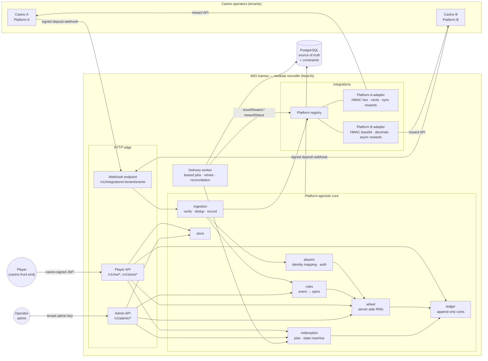
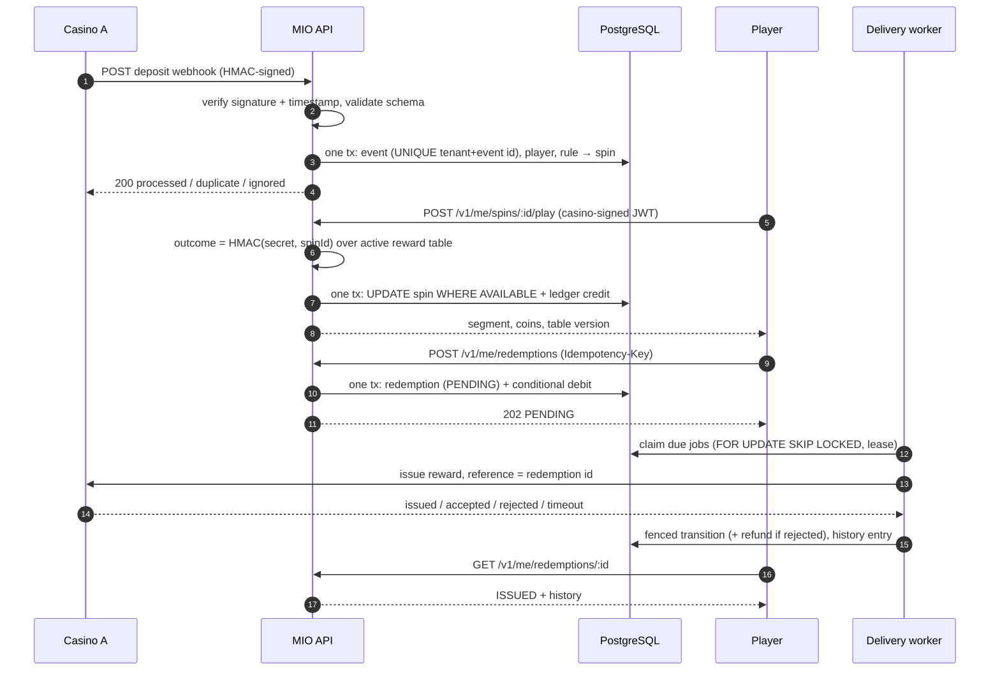
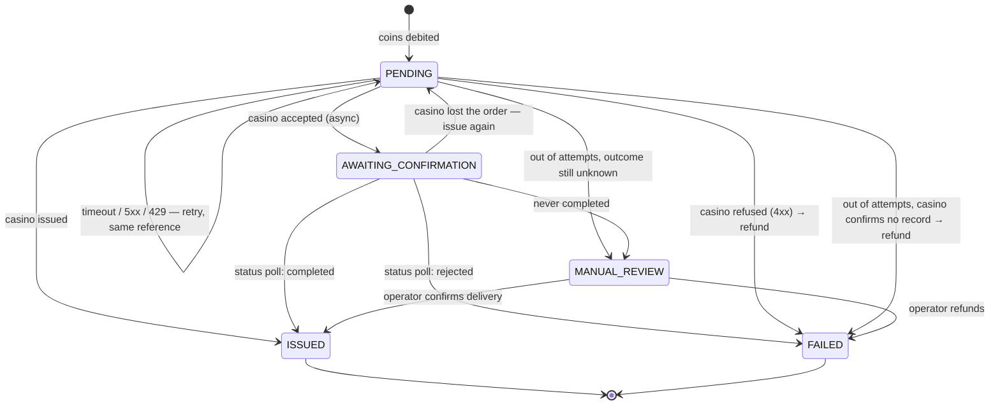

# Architecture

MIO Games is a multi-tenant gamification layer for online casinos. A casino (tenant) streams player events to MIO;
MIO turns them into game mechanics (here: a Wheel of Fortune), keeps a virtual coin economy, and asks the casino to
deliver real rewards the player buys with coins. This prototype implements that loop end to end for two casinos
whose integrations differ in every wire-level detail.

## Components

## The flow, end to end

## Redemption state machine

The transition table is a pure function (`delivery-decision.ts`) with its own unit tests; the worker only calls the
casino and records the result.

## Modules

| Module         | Responsibility                                                                                | Owns                               |
| -------------- | --------------------------------------------------------------------------------------------- | ---------------------------------- |
| `tenancy`      | Tenant lookup by id or admin key                                                              | `tenants`                          |
| `integrations` | Everything casino-specific: webhook auth and schemas, reward API formats, HTTP classification | —                                  |
| `ingestion`    | Webhook endpoint: verify → dedup → record → rules, in one transaction                         | `inbound_events`                   |
| `players`      | Identity mapping (casino id → internal id), player JWT guard                                  | `players`, `wallets` (creation)    |
| `rules`        | Event → spin grants; rule configuration                                                       | `gamification_rules`               |
| `wheel`        | Reward tables (versioned), server-authoritative spin                                          | `reward_tables`, `spins`           |
| `ledger`       | Coin postings and wallet balance                                                              | `ledger_entries`, `wallets`        |
| `store`        | Bonus Store catalogue                                                                         | `store_items`                      |
| `redemption`   | Redemptions, delivery worker, state machine, manual review                                    | `redemptions`, `redemption_events` |
| `admin`        | Admin HTTP surface and auth; logic stays in the modules above                                 | —                                  |

Core modules never see a casino payload: they work with `InboundParseResult` (normalized events),
`RewardDescriptor` and `RewardOutcome`. Adding a casino on an existing platform is a row in `tenants`;
adding a new platform is one adapter registered in `integrations.module.ts`.

## Key decisions

1. **Modular monolith on one PostgreSQL.** Every money-relevant guarantee is a transaction plus a constraint in one
   database: `UNIQUE` keys for idempotency, `CHECK (balance >= 0)`, composite foreign keys for tenant isolation,
   an append-only trigger on the ledger. Splitting this across services at prototype stage would replace those
   one-line guarantees with sagas and outboxes for no benefit.
2. **SQL stays visible (Kysely, plain SQL migrations).** The statements that carry the guarantees — conditional
   updates, `ON CONFLICT`, `FOR UPDATE SKIP LOCKED` — read as SQL in the code, which matters more here than ORM
   convenience.
3. **Webhook processing is synchronous and transactional.** Verify, record the event, map the player, evaluate rules
   and grant spins in one transaction; answer 200 only for a committed (or deduplicated) event. Casinos retry
   non-2xx, so duplicates and intentionally ignored events also get 200.
4. **One adapter contract per casino platform.** Inbound: `verifyInbound` + `parseInbound`. Outbound: `issueReward` +
   `rewardStatus`, both required to be idempotent on our reference. The two simulated platforms differ in signature
   scheme, timestamp placement, units, status codes and sync vs async issuance — and share the whole core.
5. **Server-authoritative, deterministic spins.** The client names a spin id; the outcome is
   `HMAC(SPIN_SEED_SECRET, spinId)` mapped by rejection sampling onto the active reward table. Same spin, same
   outcome (safe replays, auditable); unpredictable without the secret; unbiased for any weights. The table version
   is stored with each outcome.
6. **Append-only ledger plus a balance projection,** updated in the same transaction. Debits are conditional
   (`balance >= amount`) and the `CHECK` constraint backs that up. Corrections are compensating entries.
7. **The redemption row is the job.** No separate outbox: the worker claims due rows with `FOR UPDATE SKIP LOCKED`
   and a lease; every write after the casino call is fenced by the lease token, so a worker that lost its lease
   cannot overwrite the new owner. HTTP calls never run inside a DB transaction.
8. **A timeout is not a failure.** Unknown outcomes are retried with the same reference; when attempts run out the
   casino's status endpoint decides between ISSUED and a refund, and anything still unknown goes to a human
   (`MANUAL_REVIEW`) with the coins kept debited.

## Modules first — and what would become a service

Everything is a module in one deployable, with module boundaries that already match the likely service boundaries.
Extraction is driven by load or failure isolation, not by the prototype:

| Candidate                     | Why it would move out                                                  | Trigger                                                                                               |
| ----------------------------- | ---------------------------------------------------------------------- | ----------------------------------------------------------------------------------------------------- |
| **Delivery worker**           | Talks to external APIs, has its own failure modes and scaling needs    | Many tenants or slow casino APIs; already isolated behind `runOnce()` and `WORKER_ENABLED`            |
| **Webhook ingestion gateway** | Bursty traffic; should accept and queue even when the core is degraded | Event volume beyond what synchronous processing absorbs → inbox table or queue in front of `record()` |
| **Casino adapters**           | Per-casino deploys and credentials                                     | Dozens of platforms or partner-maintained adapters                                                    |
| Ledger                        | Kept in-process as long as possible                                    | Only if it must serve other products; it would keep its own database                                  |

## Part A coverage

| Topic                                          | Where                                                                                                                                                                                                                                         |
| ---------------------------------------------- | --------------------------------------------------------------------------------------------------------------------------------------------------------------------------------------------------------------------------------------------- |
| Multi-tenant SaaS, tenant isolation            | Tenant resolved only from credentials (webhook URL + HMAC, JWT `iss` + tenant key, admin key); `tenant_id` on every row; composite FKs `(tenant_id, …)` make cross-tenant references impossible; tests in every module                        |
| Casino integration layer                       | `src/modules/integrations`: adapter contract, registry, two platforms                                                                                                                                                                         |
| Player identity mapping                        | `players (tenant_id, external_player_id)` unique; lock-free resolution, created with the wallet on first contact                                                                                                                              |
| Event ingestion, validation, dedup, processing | `ingestion` + adapter schemas; `UNIQUE (tenant_id, external_event_id)`; raw payload kept                                                                                                                                                      |
| Gamification rules engine                      | `gamification_rules` as data (trigger, currency, threshold, spins), editable through the admin API                                                                                                                                            |
| Virtual currency ledger                        | `ledger` module, `ledger_entries` + `wallets`                                                                                                                                                                                                 |
| Reward redemption and delivery                 | `store` + `redemption`: job table, worker, state machine, reconciliation, refunds                                                                                                                                                             |
| Admin configuration                            | Tenant admin API: reward table versions, store items, rules, manual review                                                                                                                                                                    |
| Observability                                  | Structured JSON logs (pino) with correlation id from `X-Request-Id`; 4xx logged as warn, 5xx and manual reviews as error; `/health` checks the database                                                                                       |
| Auditability                                   | Raw inbound payloads, immutable reward table versions, append-only ledger with `balance_after`, redemption status history including operator decisions                                                                                        |
| Security                                       | HMAC + replay window for webhooks, casino-signed short-lived JWTs (HS256 only), hashed admin keys, constant-time signature comparison, no internal details in error responses; see [reliability-and-security.md](reliability-and-security.md) |
