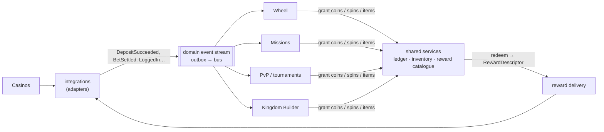

# Scaling the product (Part E)

Answers to questions 1–3, 5 and 6. Question 4 (the first 90 days) is in [90-day-plan.md](90-day-plan.md).

## 1. From prototype to production-ready multi-tenant SaaS

The prototype already carries the parts that are expensive to retrofit: tenant-scoped data with composite keys,
idempotency anchors on every money-moving effect, an append-only ledger, a durable delivery job with leases, and an
adapter contract. Production work is mostly around them:

- **Tenancy as a product.** Tenant onboarding API and back office; per-tenant configuration, feature flags, quotas
  and rate limits; secrets in a KMS with rotation; PostgreSQL row-level security as a third isolation layer;
  data export and deletion per tenant; EU data residency from day one.
- **Ingestion that never drops an event.** Keep the synchronous transaction, but put a thin inbox in front: verify,
  store the raw event, acknowledge in milliseconds, process asynchronously. A casino outage or a burst then becomes
  a backlog, not lost events or timeouts on their side.
- **Delivery as its own deployment.** Same code, separate process (`WORKER_ENABLED`), scaled on queue depth;
  per-casino concurrency limits and circuit breakers so one slow casino cannot starve the others.
- **Operability.** OpenTelemetry traces across casino → MIO → casino (the reference and request id already
  correlate them); metrics for event lag, duplicate rate, spins, delivery latency and attempts, review-queue size;
  SLOs with alerts; a nightly ledger reconciliation (sum of entries = balance, per wallet).
- **Delivery platform.** IaC (Terraform), staging that mirrors production, managed PostgreSQL with point-in-time
  recovery, blue-green deploys, expand–contract migrations, CI with the real database and mutation sampling.
- **Trust and compliance.** Operator SSO with roles and a per-person audit trail, a penetration test before the
  first live casino, RNG documentation (and certification if a market requires it for promotional mechanics),
  responsible-gaming hooks such as excluding self-excluded players from rewards.

## 2. Ten casino operators, one codebase

The key distinction is **operator vs platform**: operators run on a handful of platforms (in-house or white-label).
The code knows platforms; operators are configuration.

- **One adapter per platform, behind the existing contract** (`verifyInbound`, `parseInbound`, `issueReward`,
  `rewardStatus`). Ten operators on four platforms means four adapters and ten rows of configuration.
- **A conformance kit every adapter must pass**: the same scenario suite (signatures, replays, duplicates, status
  mapping, timeouts, idempotent issuance) run against recorded fixtures and against the casino's sandbox. A new
  adapter is "done" when the kit is green, not when it looks right.
- **Configuration, not forks.** Thresholds, rewards, reward tables, currencies, feature flags and limits per tenant.
  Platform quirks stay inside the adapter; the core never branches on a tenant id.
- **Declarative mappings only once patterns repeat.** If several platforms differ only in field names and units, a
  mapping file can replace code for them; authentication and settlement semantics stay in code.
- **Self-service onboarding.** A sandbox tenant plus the casino simulator, so an operator's engineers can test
  their webhooks and reward endpoint before we touch production.

## 3. PvP, Missions and Kingdom Builder without coupling everything to the casino layer

The casino layer has two jobs only: **turn casino traffic into normalized domain events** and **deliver a
`RewardDescriptor`**. Game features never call a casino and never see a casino payload.

- **Event stream first.** Today rules run inside the ingestion transaction. The next step is a transactional
  outbox of normalized events consumed in-process; a broker (Kafka/NATS) only when a consumer needs to scale or
  deploy separately.
- **Shared primitives instead of feature-to-feature calls**: the coin ledger, an inventory of items and boosts, a
  reward catalogue, player progress. Missions are progress trackers over events; Kingdom Builder spends coins and
  resources through the ledger; PvP is a tournament/matchmaking service fed by the same events.
- **PvP is the one likely separate service early:** real-time sessions and leaderboards have a latency and scaling
  profile unlike the rest. It still talks to the core only through events and grants.
- **Each feature owns its tables and is enabled per tenant**, so a casino can buy Missions without Kingdom Builder.

## 5. The smallest realistic team for an MVP in six months

Assuming the MVP is: two or three real casino integrations, the wheel plus missions and the Bonus Store, a player
widget embedded in the casino front end, an operator back office, and production infrastructure.

| Role                             | Allocation      | Why                                                                                |
| -------------------------------- | --------------- | ---------------------------------------------------------------------------------- |
| Founding engineer (backend lead) | full-time       | Architecture, ledger and delivery guarantees, integrations, infrastructure, hiring |
| Backend engineer                 | full-time       | Casino adapters (the long pole), missions and features                             |
| Frontend engineer                | full-time       | Player widget + embed SDK, operator back office                                    |
| Product designer                 | ~50 %           | Game UX matters as much as correctness                                             |
| DevOps / SRE                     | ~25 %, contract | IaC, observability baseline, security review                                       |

**Three engineers plus fractional design and DevOps.** Integrations dominate the risk: each casino brings
documentation gaps, sandboxes that differ from production and slow feedback loops. If PvP must be in the MVP, add a
fourth engineer for the real-time part rather than stretching the three.

## 6. What to automate with AI

How AI was used to build this prototype is in [ai-log.md](ai-log.md). In a team setting:

| Area            | Automation                                                                                                                                                                           | Human gate                                          |
| --------------- | ------------------------------------------------------------------------------------------------------------------------------------------------------------------------------------ | --------------------------------------------------- |
| Casino adapters | Draft an adapter and its fixtures from the casino's API docs; run the conformance kit                                                                                                | Engineer reviews auth and settlement semantics      |
| Tests           | Generate edge cases and property tests; **mutation testing in CI** to prove the tests are not vacuous                                                                                | Invariant tests are written or approved by a person |
| Code review     | PR review against `CLAUDE.md` invariants (idempotency anchors, tenant scoping, no locks on hot paths, no HTTP inside transactions); migration review for locking and expand–contract | Required human approval for money-moving code       |
| Operations      | Incident summaries from logs and traces; draft runbooks; review-queue triage suggestions                                                                                             | Operators decide refunds                            |
| Documentation   | API reference, casino onboarding guides, changelogs from merged PRs                                                                                                                  | Product owner signs off external docs               |
| Data            | Ledger reconciliation reports and anomaly explanations                                                                                                                               | Finance owns corrections                            |

The rule of thumb: AI writes, explains and checks; people own decisions that move money, change security posture
or set product direction.
